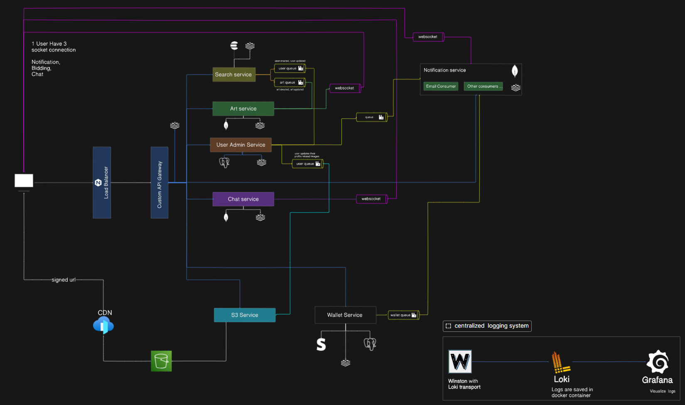

# ArtChain-2025

Welcome to **ArtChain-2025**, a comprehensive, enterprise-grade decentralized social media platform designed to bridge the gap between digital artists and art enthusiasts. Through a robust microservices ecosystem, ArtChain facilitates secure art commissions, peer-to-peer live interactions, real-time bidding, and dynamic portfolios. 

The application has been meticulously engineered using **Clean Architecture** patterns, ensuring exceptional scalability, separation of concerns, and long-term maintainability.

---


## Architecture & Tech Stack

The platform is divided into a modern React frontend client and an event-driven Node.js/TypeScript microservices backend orchestrated via **Docker** and **Nginx**.

### Frontend Tech Stack


- **TanStack Query (v5)**: Optimized server-state management, data fetching, and intelligent caching strategies.
- **shadcn/ui & Radix UI**: Accessible, customized UI components.
- **Socket.io Client & WebRTC**: Real-time messaging, notification toasts, and peer-to-peer WebRTC video calls.
- **Redux Toolkit & Redux Persist**: Complex client-side global state and session persistence.

### Backend & Infrastructure Tech Stack


- **Clean Architecture**: Strict separation of Domain, Application, Infrastructure, and Presentation layers following SOLID principles.
- **Databases**: Relational model via **PostgreSQL** (managed with Prisma ORM) alongside **MongoDB** document storage.
- **Messaging & Cache**: **RabbitMQ** event bus for asynchronous pub/sub events and **Redis** for rate limiting and Socket.IO multi-node scaling.
- **Elasticsearch**: Full-text vector search engine for artworks and user discovery.
- **Observability**: **Grafana Loki** aggregated log transport for centralized monitoring.

---

## Architecture Diagram



---

## Microservices Breakdown

Each service maps exclusively to its domain boundary, ensuring no tight-coupling between disparate features:

1. **[`api-gateway`](backend/api-gateway/README.md) (Port: 4000)**
   The edge proxy. Routes all incoming client requests to downstream services, handling JWT access policy matching and global rate-limiting.

2. **[`user-admin-service`](backend/services/user-admin-service/README.md) (Port: 4001)**
   The IAM module. Manages user registration, Google OAuth, authorization policies, profiles, artist identity verification, and admin dashboards.

3. **[`art-service`](backend/services/art-service/README.md) (Port: 4002)**
   The core art engine. Handles artworks, live auction bidding pipelines, commission workflows, and Google Gemini AI generation.

4. **[`wallet-service`](backend/services/wallet-service/README.md) (Port: 4003)**
   Finances & Escrow. Using Stripe integrations, it manages fund-locking capabilities for active commissions and withdrawals.

5. **[`elastic-search-service`](backend/services/elastic-search-service/README.md) (Port: 4004)**
   Indexes artwork and user data into Elasticsearch for full-text search.

6. **[`notification-service`](backend/services/notification-service/README.md) (Port: 4005)**
   The event listener. Broadcasts real-time in-app alerts and dispatches transactional HTML emails.

7. **[`s3-service`](backend/services/s3-service/README.md) (Port: 4006)**
   Media proxy. Uploads artwork to S3, generates CloudFront CDN links, processes watermarks, and runs pre-upload AI image moderation.

8. **[`chat-service`](backend/services/chat-service/README.md) (Port: 4007)**
   Real-time epicenter. Uses `Socket.io` and Redis Adapter for chat rooms, media attachments, and WebRTC video call signaling.

---

## Platform Capabilities

* **Mutual-Agreement Commissions**: Funds are locked in escrow, requiring dual sign-offs throughout various phases (Agreement -> In-Progress -> Delivery -> Payout).
* **Live Multimedia WebRTC Communication**: Integrated text messaging with inline media alongside peer-to-peer Video calling. 
* **Dynamic Content Loaders**: Customized skeleton loading screens in `shadcn` with optimized caching via `TanStack Query`.
* **Centralized Observability**: Log aggregation via **Loki** into customizable **Grafana** health tracking dashboards.

---

## Getting Started

### Prerequisites
* **Node.js**: v18+ recommended.
* **Docker & Docker Compose**: Native installations required for infrastructure spinning.

### Running the Ecosystem

1. **Environment Setup**: Populate the `.env` roots throughout the distinct service directories using their respective `.env.docker` or `.env.example` templates.
2. **Database Initialization**: If running for the first time, boot the database instances via the shell scripts:
   ```bash
   # Unix environments
   bash backend/init-multiple-dbs.sh
   
   # Windows environments
   ./backend/start-all.ps1
   ```
3. **Container Orchestration**: Spin up the backend infrastructure:
   ```bash
   cd backend
   docker compose up -d --build
   ```
4. **Accessing the Stack**:
   * Frontend Application: Run `cd frontend && npm run dev`
   * PgAdmin Dashboard: Accessible at `localhost:8080`.
   * Grafana Observability Dashboard: Accessible at `localhost:3000`.

---

**ArtChain-2025** — Setting the modern standard for Decentralized Art Ecosystems.
